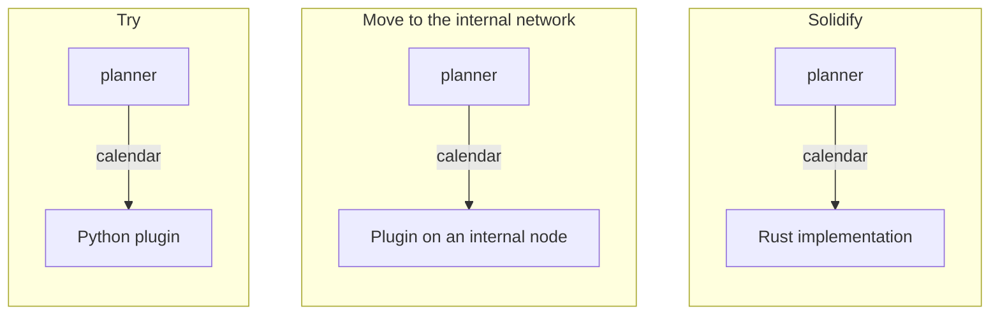
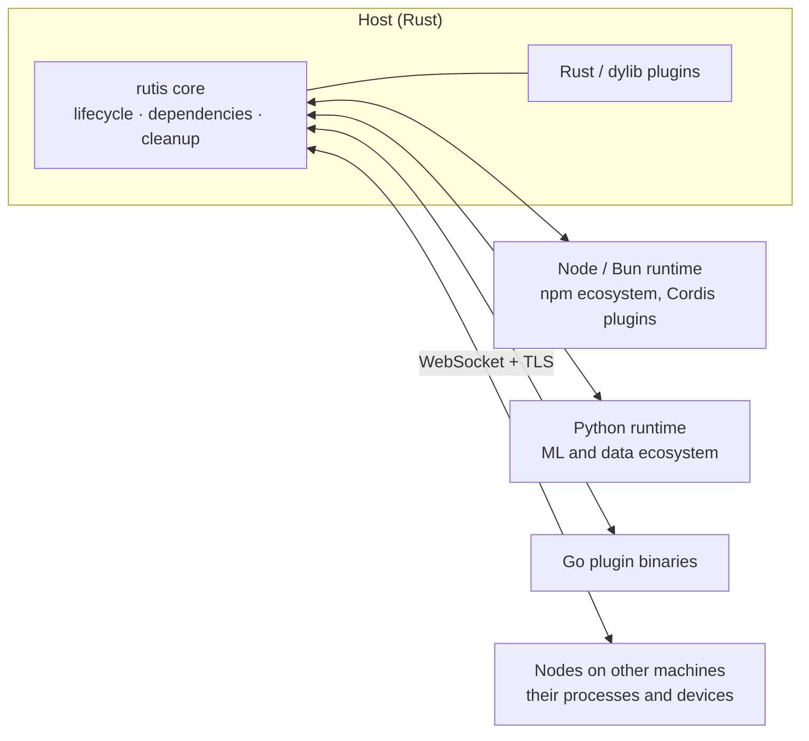
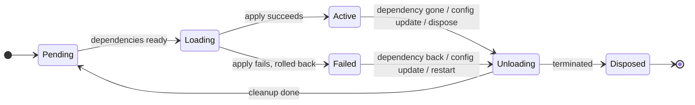

<div align="center">

<picture>
  <source media="(prefers-color-scheme: dark)" srcset="assets/logo/brand/rutis-lockup-inverse.svg">
  
</picture>

# rutis

**A plugin runtime for software that iterates on itself**

Agents and long-running programs write, swap and hot-reload their own plugins, and rutis keeps every change safe.<br>
A Rust core · plugins in TypeScript, Python and Go · across processes and machines

[](https://crates.io/crates/rutis)
[](https://www.npmjs.com/package/@arcships/rutis)
[](https://pypi.org/project/rutis/)
[](https://docs.rs/rutis)
[](https://github.com/arcships/rutis/actions/workflows/ci.yml)
[](LICENSE)

[Quick start](#quick-start) · [Guides](docs/guide/README.en.md) · [Design philosophy](docs/design-philosophy.en.md) · [API docs](https://docs.rs/rutis) · [中文](README.zh-CN.md)

</div>

<br>

When software is itself an agent, or is built by agents, it cannot wait for someone else to wrap the world for it. To reach a new API, model, tool or device, it writes a plugin, tries it, changes it and replaces it, while it keeps running. The connection then becomes part of the program: with a lifecycle, visible, and cleaned up when it goes.

Doing that over and over is only safe on a runtime that guarantees a few things: nothing starts before what it depends on is there; everything a plugin registered is released exactly once when it stops; a failed load rolls back; and when an implementation is replaced, only what uses it restarts. rutis is that runtime. Plugins declare the services they need and provide, and rutis decides when they start, stop and start again.

The lifecycle model comes from [Cordis](https://github.com/shigma/cordis). rutis implements it once, in a small Rust core, and carries it to other languages, other processes and other machines.

## The loop

| | What rutis gives you |
| --- | --- |
| **Make** a connection | `rutis-host new --lang node\|bun\|python\|go` creates a plugin project. Plugins run in the host's process, in a language runtime, or on another machine, and call each other's services by name. |
| **Understand** it | `rutis-host check` lists every plugin's dependencies and what it provides, and fails on a service nothing provides. In Rust, `ctx.diagnostics()` shows each plugin's state, dependencies and bindings. |
| **Iterate** on it | `rutis-host dev` reloads a plugin when its files change. Configuration updates live. Replace a provider, even with one in another language, and the plugins using it follow. |
| **Without breaking** | Gated start, LIFO cleanup that runs exactly once, rollback on failure. Synchronous calls that would deadlock across runtimes are refused. Loading, unloading and replacing again and again leaves nothing behind. |

## Quick start

### Without Rust

```bash
npx @arcships/rutis-host new weather --lang node
cd weather && npm install
npx rutis-host dev          # run the plugin, reload it when files change
npx rutis-host check        # what each plugin needs and provides
```

The same works for other languages: `bunx --bun @arcships/rutis-host new weather --lang bun`, `uvx rutis-host new weather --lang python` (then `uv sync`, `uv run rutis-host dev`), or `rutis-host new weather --lang go` (then `go mod tidy`, `rutis-host dev`).

```ts
import { definePlugin } from '@arcships/rutis'

interface Llm {
  ask(question: string): Promise<string>
}

export default definePlugin<{ city?: string }>({
  inject: ['llm'],                             // services it needs: starts once all are there
  apply(ctx, config) {
    const llm = ctx.use<Llm>('llm')
    const city = config.city ?? 'Oslo'
    ctx.provide('weather', {                   // the service it offers, by name, to every language
      today: () => llm.ask(`weather in ${city}`),
    })
  },
})
```

`llm` can come from another plugin in the same process, from a Python plugin, or from another machine; this plugin stays the same. The full workflow is in the guides for [TypeScript](docs/guide/typescript-plugin.en.md), [Bun](docs/guide/bun-plugin.en.md), [Python](docs/guide/python-plugin.en.md) and [Go](docs/guide/go-plugin.en.md).

### In Rust

```bash
cargo add rutis
cargo add tokio --features full
```

```rust
use std::sync::Arc;
use rutis::{BoxFuture, CordisError, Ctx, Effect, Plugin, Typed, TypedPlugin};

/// A service is a type.
struct Greeting(String);

/// Provides Greeting. What apply registers is released when the plugin stops.
struct Greeter(&'static str);

impl Plugin for Greeter {
    fn name(&self) -> &str { "greeter" }

    fn apply<'a>(&'a self, ctx: &'a Ctx) -> BoxFuture<'a, Result<Effect, CordisError>> {
        Box::pin(async move {
            ctx.provide(Greeting(format!("hello from {}", self.0)))?;
            Ok(Effect::Done)
        })
    }
}

/// Depends on Greeting: starts when it appears, restarts when it is replaced.
struct Listener;

impl TypedPlugin for Listener {
    type Deps = (Arc<Greeting>,);

    fn name(&self) -> &str { "listener" }

    fn apply<'a>(&'a self, _: &'a Ctx, (greeting,): Self::Deps) -> BoxFuture<'a, Result<Effect, CordisError>> {
        Box::pin(async move {
            println!("{}", greeting.0);
            Ok(Effect::Done)
        })
    }
}

#[tokio::main]
async fn main() -> Result<(), Box<dyn std::error::Error>> {
    let ctx = Ctx::root()?;
    let listener = ctx.plugin(Typed::new(Listener));  // waits for a Greeting

    let english = ctx.plugin(Greeter("English"));
    (&english).await?;
    (&listener).await?;                               // hello from English

    english.dispose().await?;                         // the listener stops…
    let esperanto = ctx.plugin(Greeter("Esperanto"));
    (&esperanto).await?;
    (&listener).await?;                               // …and starts again: hello from Esperanto

    ctx.shutdown().await?;
    Ok(())
}
```

Nothing touched `Listener`: when the provider changed, it stopped and started again on its own. Run it from the repository with `cargo run -p rutis --example quickstart`. To run TypeScript, Python and Go plugins inside your Rust application, see [embedding in Rust](docs/guide/rust-host.en.md).

## From experiment to production

A plugin depends on a service's **name**, never on its implementation, its language or where it runs. So a capability can start as a quick experiment and harden over time, while everything that uses it stays the same:

1. **Try**: write it in Python or TypeScript, perhaps with an agent, and let `rutis-host dev` reload it on every change.
2. **Prove**: run it in a real host, using and used by other plugins; the service's name and methods settle here.
3. **Solidify**: move it to another machine, or rewrite the parts that have stood the test of time in Rust.



Across all three stages, not one line of `planner` changes and the host does not restart.

## How it works

rutis is a small application operating system. The core is the kernel; everything it connects to is a plugin under the same lifecycle:

| Operating system | rutis |
| --- | --- |
| Kernel: small, stable, rarely changed | The `rutis` core, depending only on tokio, tokio-util and thiserror |
| Processes | Plugins; language runtimes, remote nodes and dylibs are plugins too |
| System calls | Services, provided and used by name or by type |
| Drivers | Language runtimes, node links, Cordis mounts |
| Scheduling and reclamation | Start once dependencies are ready, stop when they go away, clean up in reverse order |



The lifecycle model lives only in the core, and every guarantee is pinned by tests; the other languages get a small SDK instead of a copy of the framework. Each plugin runs in a fiber whose state follows its dependencies:



Services are registered by type in Rust and by name across languages. The event bus dispatches in four ways: emit, parallel, serial and waterfall. `rutis-loader` describes the plugins to run as layered configuration and keeps reconciling the running system toward it. Hosts link over WebSocket and TLS to share services, run plugins on another machine, forward events and reconnect after a drop.

## Trade-offs

- **Processes and latency**: each language needs at least one process, and a synchronous cross-language call takes about 30 µs (measured on the Node side). Hot paths belong in Rust or in one runtime.
- **Weaker semantics across a boundary**: events become notifications and waterfalls are not forwarded; what cannot cross a boundary is a [written rule](docs/requirements-protocol-plugins.en.md), not a silent degradation.
- **Shared failure**: plugins in one runtime share its process. Isolation means more runtime instances.

The [design philosophy](docs/design-philosophy.en.md) explains these choices, and how rutis differs from Cordis.

## Packages

| For | Rust (crates.io) | JavaScript (npm) | Python (PyPI) |
| --- | --- | --- | --- |
| The core | [`rutis`](https://crates.io/crates/rutis) | | |
| Writing plugins | [`rutis-sdk`](https://crates.io/crates/rutis-sdk) (dylib plugins) | [`@arcships/rutis`](https://www.npmjs.com/package/@arcships/rutis) | [`rutis`](https://pypi.org/project/rutis/) |
| Running plugins in your app | [`rutis-loader`](https://crates.io/crates/rutis-loader), [`rutis-bridge`](https://crates.io/crates/rutis-bridge), [`rutis-dylib`](https://crates.io/crates/rutis-dylib) (dylib plugins) | [`@arcships/rutis-runtime`](https://www.npmjs.com/package/@arcships/rutis-runtime) (Node), [`@arcships/rutis-bun`](https://www.npmjs.com/package/@arcships/rutis-bun) (Bun) | [`rutis`](https://pypi.org/project/rutis/) |
| A host without Rust | [`rutis-host`](https://crates.io/crates/rutis-host) | [`@arcships/rutis-host`](https://www.npmjs.com/package/@arcships/rutis-host) | [`rutis-host`](https://pypi.org/project/rutis-host/) |

Go plugins use the module [`github.com/arcships/rutis/go/rutis`](go/rutis): the SDK, and the runtime each plugin binary carries.

All of these form a release train: released together at one version, currently 0.12. Use the same version for every rutis package.

## Built with rutis

| Project | |
| --- | --- |
| [rutis-agent](crates/rutis-agent) · [rutis-cli](crates/rutis-cli) | A minimal coding agent in which the model service, tools, streaming driver and TUI are all plugins. Try it offline with `cargo run -p rutis-cli -- --scripted`. |
| [rutis-host](crates/rutis-host) | A host without Rust: runs TypeScript, JavaScript, Python and Go plugins from a `rutis.json`, reloads them during development, links machines. |
| [rutis-dsh](crates/rutis-dsh) | Runs the full dsh web interface inside a rutis host, with model calls served by aimux in the same process. |
| [aimux-llm](crates/aimux-llm) | Wraps [aimux](https://crates.io/crates/aimux-core) as an LLM service plugin. |

## Documentation

- **[Guides](docs/guide/README.en.md)**: organized by task. Plugins in TypeScript, Bun, Python and Go, running rutis-host, linking nodes, embedding in Rust, working with Cordis.
- **[Design philosophy](docs/design-philosophy.en.md)**: why rutis exists, the shape that follows, its costs and principles.
- **[Application design guide](docs/development-guide.en.md)**: splitting an app into plugins, drawing the dependency graph, designing reloads and multiple instances.
- **[Development handbook](docs/development-handbook.en.md)**: API usage, resource cleanup, events, troubleshooting and verification.
- **[Core features](docs/core-features.en.md)**: config hot update, dynamic events, interception, diagnostics, and the boundaries of each.
- **[Guarantee registry](docs/guarantees.en.md)**: what rutis promises, at what level, and which tests verify each promise.
- **[API docs](https://docs.rs/rutis)**: the complete reference on docs.rs.
- **Design records**: the [core design](docs/design-rust-port.en.md), the [spec-by-spec parity check against Cordis](docs/cordis-spec-parity-2026-08-18.en.md), and every design record in [docs](docs).
- **Upgrading**: [0.8 → 0.9](docs/migration-0.8-to-0.9.en.md) · [0.7 → 0.8](docs/migration-0.7-to-0.8.en.md) · [from rutis-interop to 0.7](docs/migration-interop-to-0.7.en.md) · [0.6.0 → 0.6.1](docs/migration-0.6.0-to-0.6.1.en.md) · [0.5 → 0.6](docs/migration-0.5-to-0.6.en.md) · [0.3 → 0.5](docs/migration-0.3-to-0.5.en.md) · [0.1 → 0.2](docs/migration-0.1-to-0.2.en.md)

## Platforms and status

rutis is at 0.x and its API is still evolving. Breaking changes are listed in the release notes and come with a migration guide.

- **The core** is pure Rust with tokio, tokio-util and thiserror as its only dependencies; it needs Rust 1.88 or later.
- **Language runtimes and rutis-host** (Node, Bun, Python and Go rows, remote runtimes, shared services, peers, Cordis mounts) run on Linux, macOS and Windows x64 (MSVC); they need Node 22+, Bun 1.4+ or Python 3.10+; Go plugins are compiled binaries, built with Go 1.24+. The Bun runtime is not tested on Windows yet.
- **dylib plugins** load on Linux, macOS and Windows x64 (MSVC).

## Contributing

Issues and pull requests are welcome: bugs, places where the docs are unclear, features you would like. Please read the [contributing guide](CONTRIBUTING.md) first, and report security issues privately as described in the [security policy](SECURITY.md).

## Acknowledgements and license

The design of rutis comes from [Cordis](https://github.com/shigma/cordis) by [Shigma](https://github.com/shigma). Without Cordis's thinking about plugins, contexts and dependencies, this project would not exist.

Released under the [MIT](LICENSE) license.
