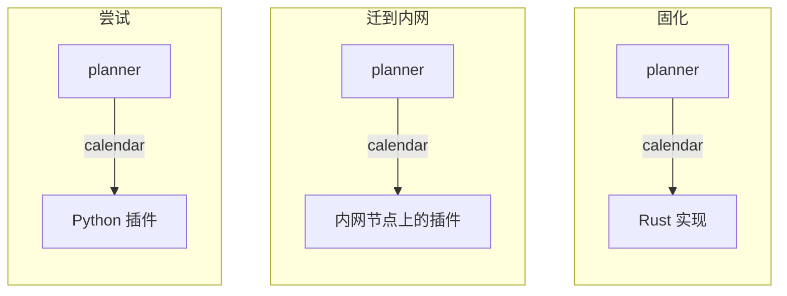
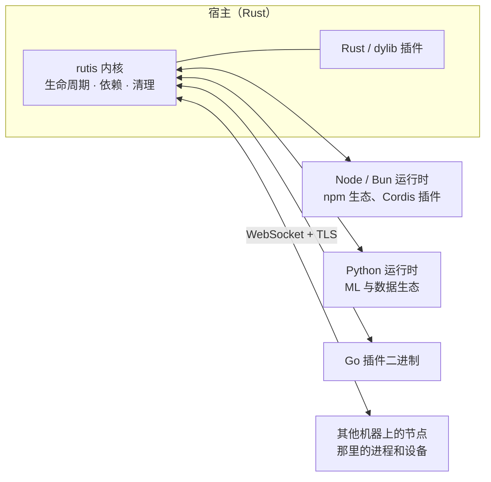
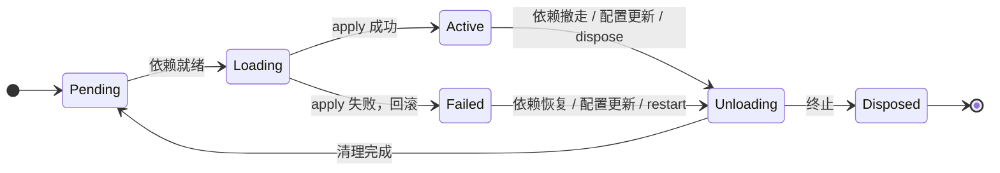

<div align="center">

<picture>
  <source media="(prefers-color-scheme: dark)" srcset="assets/logo/brand/rutis-lockup-inverse.svg">
  
</picture>

# rutis

**为自我迭代的软件准备的插件运行时**

agent 和长期运行的程序自己写插件、换插件、热重载插件，rutis 保证每一次变化都安全。<br>
Rust 内核 · TypeScript、Python 与 Go 插件 · 跨进程，跨机器

[](https://crates.io/crates/rutis)
[](https://www.npmjs.com/package/@arcships/rutis)
[](https://pypi.org/project/rutis/)
[](https://docs.rs/rutis)
[](https://github.com/arcships/rutis/actions/workflows/ci.yml)
[](LICENSE)

[快速开始](#快速开始) · [指南](docs/guide/README.md) · [设计哲学](docs/design-philosophy.md) · [API 文档](https://docs.rs/rutis) · [English](README.md)

</div>

<br>

当软件本身就是 agent，或者由 agent 来开发，它不能等别人把外部世界包装好再来用。要接一个新的 API、模型、工具或设备，它自己写插件、试、改、替换，而且不停下来。接好的连接从此成为程序的一部分：有生命周期，看得见，撤走时清理干净。

反复这样做，只有在运行时提供几条保证时才安全：依赖没到就不启动；插件注册的一切，停下时恰好释放一次；装载失败会回滚；换掉一个实现，只有用到它的部分重启。rutis 就是这样的运行时。插件声明自己需要和提供哪些服务，何时启动、停下、重来，由 rutis 决定。

这套生命周期模型来自 [Cordis](https://github.com/shigma/cordis)。rutis 在一个小的 Rust 内核里把它实现一份，再带到其他语言、其他进程和其他机器上。

## 迭代的循环

| | rutis 提供什么 |
| --- | --- |
| **建立**连接 | `rutis-host new --lang node\|bun\|python\|go` 创建插件项目。插件可以跑在宿主进程里、语言运行时里或另一台机器上，按名字调用彼此的服务。 |
| **认识**连接 | `rutis-host check` 列出每个插件的依赖和提供的服务，有服务没人提供时报错。在 Rust 里，`ctx.diagnostics()` 给出每个插件的状态、依赖和绑定。 |
| **迭代**连接 | `rutis-host dev` 在文件改动时重新加载插件。配置热更新。换掉一个提供者，哪怕换成另一种语言写的，使用它的插件也会跟上。 |
| **迭代中不出错** | 依赖就绪才启动，卸载时按 LIFO 恰好清理一次，失败时回滚。跨运行时会死锁的同步调用会被拒绝。频繁地装上、卸下、替换，也不会留下残留。 |

## 快速开始

### 不写 Rust

```bash
npx @arcships/rutis-host new weather --lang node
cd weather && npm install
npx rutis-host dev          # 运行插件，文件改动时自动重载
npx rutis-host check        # 每个插件需要什么、提供什么
```

其他语言也一样：`bunx --bun @arcships/rutis-host new weather --lang bun`；`uvx rutis-host new weather --lang python`（再 `uv sync`、`uv run rutis-host dev`）；`rutis-host new weather --lang go`（再 `go mod tidy`、`rutis-host dev`）。

```ts
import { definePlugin } from '@arcships/rutis'

interface Llm {
  ask(question: string): Promise<string>
}

export default definePlugin<{ city?: string }>({
  inject: ['llm'],                             // 需要的服务：都就绪才启动
  apply(ctx, config) {
    const llm = ctx.use<Llm>('llm')
    const city = config.city ?? 'Oslo'
    ctx.provide('weather', {                   // 提供的服务，各语言按名字使用
      today: () => llm.ask(`weather in ${city}`),
    })
  },
})
```

`llm` 可以来自同一进程里的另一个插件、一个 Python 插件，或者另一台机器，这个插件都不用改。完整流程见 [TypeScript](docs/guide/typescript-plugin.md)、[Bun](docs/guide/bun-plugin.md)、[Python](docs/guide/python-plugin.md) 和 [Go](docs/guide/go-plugin.md) 插件指南。

### 在 Rust 中

```bash
cargo add rutis
cargo add tokio --features full
```

```rust
use std::sync::Arc;
use rutis::{BoxFuture, CordisError, Ctx, Effect, Plugin, Typed, TypedPlugin};

/// 服务就是一个类型。
struct Greeting(String);

/// 提供 Greeting。apply 里注册的东西，插件停下时自动释放。
struct Greeter(&'static str);

impl Plugin for Greeter {
    fn name(&self) -> &str { "greeter" }

    fn apply<'a>(&'a self, ctx: &'a Ctx) -> BoxFuture<'a, Result<Effect, CordisError>> {
        Box::pin(async move {
            ctx.provide(Greeting(format!("hello from {}", self.0)))?;
            Ok(Effect::Done)
        })
    }
}

/// 依赖 Greeting：它出现时启动，被替换时重启。
struct Listener;

impl TypedPlugin for Listener {
    type Deps = (Arc<Greeting>,);

    fn name(&self) -> &str { "listener" }

    fn apply<'a>(&'a self, _: &'a Ctx, (greeting,): Self::Deps) -> BoxFuture<'a, Result<Effect, CordisError>> {
        Box::pin(async move {
            println!("{}", greeting.0);
            Ok(Effect::Done)
        })
    }
}

#[tokio::main]
async fn main() -> Result<(), Box<dyn std::error::Error>> {
    let ctx = Ctx::root()?;
    let listener = ctx.plugin(Typed::new(Listener));  // 等待 Greeting

    let english = ctx.plugin(Greeter("English"));
    (&english).await?;
    (&listener).await?;                               // hello from English

    english.dispose().await?;                         // listener 随之停下……
    let esperanto = ctx.plugin(Greeter("Esperanto"));
    (&esperanto).await?;
    (&listener).await?;                               // ……又自动启动：hello from Esperanto

    ctx.shutdown().await?;
    Ok(())
}
```

没有人碰过 `Listener`：provider 一换，它就跟着停下、再启动。在仓库里运行：`cargo run -p rutis --example quickstart`。要在 Rust 应用里运行 TypeScript、Python 和 Go 插件，见 [在 Rust 中嵌入](docs/guide/rust-host.md)。

## 从尝试到落地

插件依赖的是服务的**名字**，不是它的实现、语言或运行位置。所以一项能力可以从快速的尝试开始，逐步变得可靠，使用它的一切都不用改：

1. **尝试**：用 Python 或 TypeScript 写，可以交给 agent 来写，`rutis-host dev` 下改了就重新加载。
2. **验证**：在真实的宿主里运行，和其他插件互相使用服务，服务的名字和方法在这一步稳定下来。
3. **固化**：挪到另一台机器上，或者把经过时间验证的部分改写成 Rust。



三个阶段里，`planner` 一行代码都不用改，宿主也不用重启。

## 工作方式

rutis 是一个小的应用操作系统：`rutis` 内核相当于操作系统的内核，它连接的一切都是插件，受同一套生命周期管理：

| 操作系统 | rutis |
| --- | --- |
| 内核：小、稳定、很少改 | `rutis` 内核，只依赖 tokio、tokio-util、thiserror |
| 进程 | 插件；语言运行时、远端节点、dylib 也都是插件 |
| 系统调用 | 服务，按名字或类型提供和使用 |
| 驱动 | 语言运行时、节点连接、Cordis 挂载 |
| 调度与回收 | 依赖就绪才启动，依赖消失就停下，按注册的逆序清理 |



生命周期模型只在内核里实现，每一条保证都用测试钉住；其他语言只有一个很小的 SDK，不复刻框架。每个插件运行在一个 fiber 里，fiber 的状态随依赖变化：



服务在 Rust 里以类型为键，跨语言时按名字。事件总线提供 emit、parallel、serial、waterfall 四种分发方式。`rutis-loader` 用分层配置描述要运行的插件，并持续把运行中的系统调和到这个状态。宿主之间通过 WebSocket 与 TLS 互联：共享服务、在另一台机器上运行插件、转发事件、断线后重连。

## 代价

- **进程与延迟**：每种语言至少一个进程，跨语言的同步调用约 30 µs（Node 侧实测）。调用频繁的路径应该放在 Rust 或同一个运行时里。
- **跨边界的语义更弱**：事件只能是通知，waterfall 不转发；做不到的事写成[边界规则](docs/requirements-protocol-plugins.md)，不悄悄降级。
- **故障范围**：同一个运行时里的插件共享一个进程。要隔离，就多开运行时实例。

这些取舍的理由，以及 rutis 和 Cordis 的根本区别，见 [设计哲学](docs/design-philosophy.md)。

## 包

| 用途 | Rust（crates.io） | JavaScript（npm） | Python（PyPI） |
| --- | --- | --- | --- |
| 内核 | [`rutis`](https://crates.io/crates/rutis) | | |
| 写插件 | [`rutis-sdk`](https://crates.io/crates/rutis-sdk)（dylib 插件） | [`@arcships/rutis`](https://www.npmjs.com/package/@arcships/rutis) | [`rutis`](https://pypi.org/project/rutis/) |
| 在应用中运行插件 | [`rutis-loader`](https://crates.io/crates/rutis-loader)、[`rutis-bridge`](https://crates.io/crates/rutis-bridge)、[`rutis-dylib`](https://crates.io/crates/rutis-dylib)（dylib 插件） | [`@arcships/rutis-runtime`](https://www.npmjs.com/package/@arcships/rutis-runtime)（Node）、[`@arcships/rutis-bun`](https://www.npmjs.com/package/@arcships/rutis-bun)（Bun） | [`rutis`](https://pypi.org/project/rutis/) |
| 不写 Rust 的宿主 | [`rutis-host`](https://crates.io/crates/rutis-host) | [`@arcships/rutis-host`](https://www.npmjs.com/package/@arcships/rutis-host) | [`rutis-host`](https://pypi.org/project/rutis-host/) |

Go 插件用模块 [`github.com/arcships/rutis/go/rutis`](go/rutis)：SDK，以及每个插件二进制自带的运行时。

以上所有包组成发布列车，一起发布、版本相同，当前为 0.11。各个 rutis 包请使用同一个版本。

## 用 rutis 构建

| 项目 | |
| --- | --- |
| [rutis-agent](crates/rutis-agent) · [rutis-cli](crates/rutis-cli) | 最小的 coding agent：模型服务、工具、流式驱动和 TUI 都是插件。`cargo run -p rutis-cli -- --scripted` 可以离线体验。 |
| [rutis-host](crates/rutis-host) | 不写 Rust 的宿主：按 `rutis.json` 运行 TypeScript、JavaScript、Python 和 Go 插件，开发时自动重载，连接多台机器。 |
| [rutis-dsh](crates/rutis-dsh) | 在 rutis 宿主里运行 dsh 的完整 web 界面，模型调用由同进程的 aimux 提供。 |
| [aimux-llm](crates/aimux-llm) | 把 [aimux](https://crates.io/crates/aimux-core) 包装成一个 LLM 服务插件。 |

## 文档

- **[指南](docs/guide/README.md)**：按任务组织。写 TypeScript / Bun / Python / Go 插件、运行 rutis-host、连接节点、在 Rust 中嵌入、与 Cordis 互通。
- **[设计哲学](docs/design-philosophy.md)**：rutis 为什么存在，由此而来的形态、代价和原则。
- **[应用设计指南](docs/development-guide.md)**：如何拆分插件、画依赖图、设计重载与多实例。
- **[开发手册](docs/development-handbook.md)**：API 用法、资源清理、事件、排障与验证。
- **[内核能力一览](docs/core-features.md)**：配置热更新、动态事件、拦截、诊断，以及各自的使用边界。
- **[保证登记表](docs/guarantees.md)**：rutis 承诺了什么、属于哪一级、由哪些测试验证。
- **[API 文档](https://docs.rs/rutis)**：docs.rs 上的完整参考。
- **设计记录**：[内核设计](docs/design-rust-port.md)、[与 Cordis 的逐条对拍](docs/cordis-spec-parity-2026-08-18.md)，以及 [docs](docs) 目录下的全部设计记录。
- **升级**：[0.8 → 0.9](docs/migration-0.8-to-0.9.md) · [0.7 → 0.8](docs/migration-0.7-to-0.8.md) · [从 rutis-interop 迁移到 0.7](docs/migration-interop-to-0.7.md) · [0.6.0 → 0.6.1](docs/migration-0.6.0-to-0.6.1.md) · [0.5 → 0.6](docs/migration-0.5-to-0.6.md) · [0.3 → 0.5](docs/migration-0.3-to-0.5.md) · [0.1 → 0.2](docs/migration-0.1-to-0.2.md)

## 平台与状态

rutis 仍处于 0.x，API 还会演进。不兼容的变化会写进发布说明，并附迁移指南。

- **内核** 是纯 Rust，依赖只有 tokio、tokio-util 和 thiserror；需要 Rust 1.88 或更高。
- **语言运行时与 rutis-host**（Node、Bun、Python 与 Go 行、远程运行时、跨语言共享服务、节点、Cordis 挂载）支持 Linux、macOS 和 Windows x64（MSVC）；需要 Node 22+、Bun 1.4+ 或 Python 3.10+；Go 插件是编译好的二进制，构建时需要 Go 1.24+。Bun 运行时还没有在 Windows 上测试。
- **dylib 插件** 支持 Linux、macOS 和 Windows x64（MSVC）。

## 参与

欢迎提 issue 和 pull request：bug、文档里说不清的地方、想要的功能，都可以。开始之前请读 [贡献指南](CONTRIBUTING.zh-CN.md)；安全问题请按 [安全策略](SECURITY.md) 私下报告。

## 致谢与许可

rutis 的设计源自 [Shigma](https://github.com/shigma) 的 [Cordis](https://github.com/shigma/cordis)。没有 Cordis 对插件、上下文与依赖的思考，就不会有这个项目。

以 [MIT](LICENSE) 许可发布。
