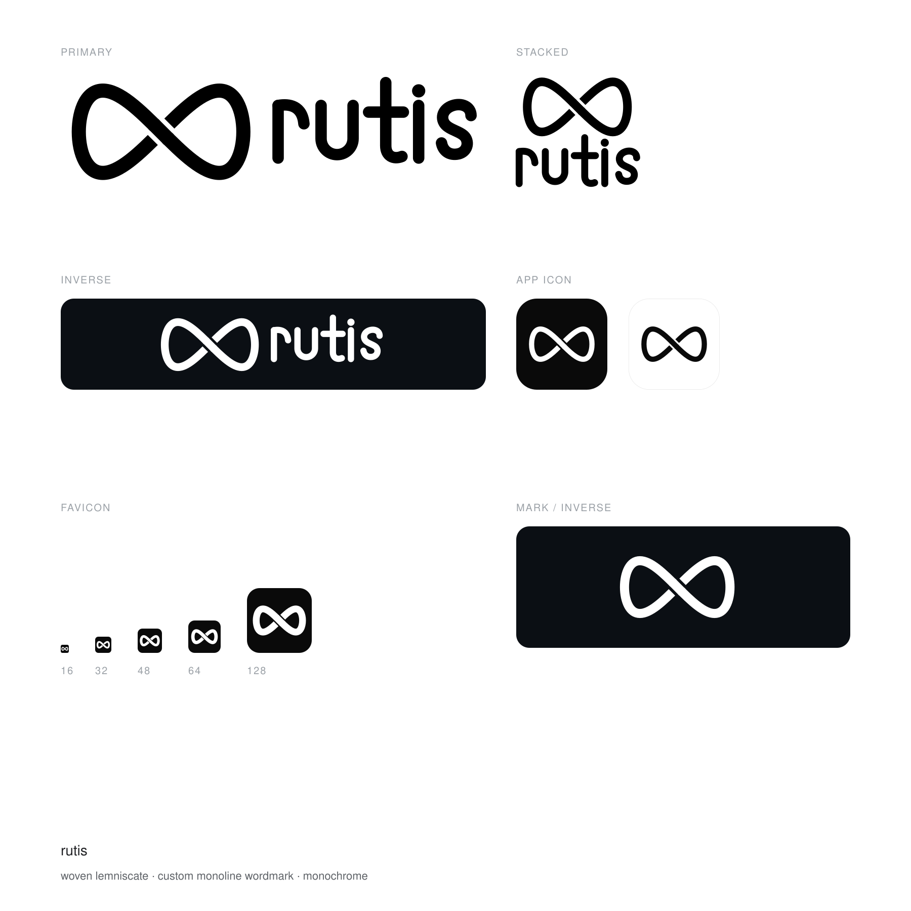

# rutis logo

The mark is a **woven lemniscate**: one ribbon that loops and passes over then
under itself. It states the two things rutis does — software that iterates in a
closed loop, and an implementation being replaced while the same connection
carries on. The wordmark is a custom monoline alphabet (only `r u t i s` exist),
drawn with the same single stroke weight and round terminals as the ribbon, so
mark and name read as one material.



## Assets

| File | Use |
| --- | --- |
| `rutis-logo.svg` | **Master.** The vector original: mark + wordmark as pure paths. No font dependency (not a single `<text>` in the file). |
| `rutis-lockup.svg` | Same artwork, kept inside `brand/` for the asset set. |
| `rutis-lockup-inverse.svg` | Same, white, for dark backgrounds. |
| `rutis-lockup-stacked.svg` | Vertical, for square or narrow slots. |
| `rutis-mark.svg` | Mark alone. Light backgrounds. |
| `rutis-mark-inverse.svg` | Mark alone, white. |
| `rutis-icon-dark.svg` / `rutis-icon-light.svg` | 1024 rounded-square app icon. |
| `favicon.svg` | Optically corrected tile: heavier stroke and tighter padding. |
| `favicon/icon-{16,32,48,64,128,180,256,512}.png`, `favicon/favicon.ico` | Raster sizes. |

All SVGs are vector, monochrome and **transparent-background** — the weave gap
is cut with a mask, not painted over, so the mark composites onto any colour.

## Promotional banner

`banner/` holds 16:9 raster hero images (2048×1152) for the README header and
social cards: snow-mountain scenes with a chrome ∞ and the name.

| File | Look |
| --- | --- |
| `banner-bluehour.png` | Blue hour, stars and moon, brushed-steel ∞ and wordmark |
| `banner-lockup.png` | Daylight; mark on the left, large wordmark on the right |
| `banner-sunrise.png` | Golden sunrise, polished chrome ∞ |
| `banner-dawn.png` | Dawn alpenglow, liquid-chrome ∞ |

These are **promo art, not the identity**. They were produced by an image model
and the ∞ in them is a re-interpretation — a 3D extruded ribbon — not the
woven-lemniscate geometry of the vector mark above, so do not use them where
the mark must be exact. For anything load-bearing, use `rutis-lockup.svg`.
`banner/` is kept locally and is not committed — see [Not part of the
set](#not-part-of-the-set).

## Colour

| Role | Value |
| --- | --- |
| Ink (light backgrounds) | `#000000` |
| Ink (dark backgrounds) | `#FFFFFF` |
| App-icon tile | `#0A0A0A` |
| Light icon border | `#E4E4E4` |

One ink only. On an arbitrary background photo or colour, use the app-icon tile
rather than laying the bare mark on it.

## Usage

- **Clear space**: leave at least the ribbon thickness (≈ 1/7 of the mark
  height) free on every side.
- **Minimum sizes**: mark alone ≥ 20 px high; horizontal lockup ≥ 24 px high or
  110 px wide. Below 32 px use `favicon.svg`, which is drawn heavier so the
  weave survives.
- **Do not**: stretch or condense, re-colour beyond the two inks, add shadows,
  outlines, gradients or rotation, re-space the wordmark, or re-set `rutis` in
  another typeface.

## Regenerating

Everything here is generated — no hand-edited SVGs.

```bash
python3.14 tools/logo/gen_rutis_mark.py    # mark geometry variants (assets/logo/vector)
python3.14 tools/logo/rutis_letters.py      # wordmark letterforms (preview)
python3.14 tools/logo/gen_rutis_brand.py    # mark / lockups / icons / favicon.svg
python3.14 tools/logo/gen_rutis_sheet.py    # brand-sheet.svg

# raster favicons (needs qlmanage + ImageMagick)
qlmanage -t -s 1024 -o assets/logo/brand/favicon assets/logo/brand/favicon.svg
magick assets/logo/brand/favicon/favicon.svg.png -resize 32x32 assets/logo/brand/favicon/icon-32.png
```

`tools/logo/rutis_letters.py` holds the only hand-tuned numbers that matter:
`XH` (x-height), `S` (stroke weight), `TRACK` (letter-spacing) and the per-glyph
paths.

## Not part of the set

`assets/logo/candidate-*.png`, `assets/logo/r2/`, `assets/logo/r3/` and
`assets/logo/vector/rutis-v{2,3,4}-*.svg` are exploration from an earlier round
(model-generated candidates, and the bead / plain / coupling variants of the
mark) kept only for provenance. Nothing in the brand set depends on them.
Together with `banner/` and `brand/preview/`, they are kept locally and
excluded via `.gitignore`; the repository tracks only the identity set above
plus the generator scripts in `tools/logo/`.
