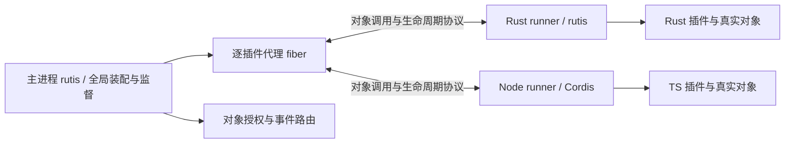

# 协议插件设计：基于 rutis / Cordis 的跨语言对象与插件体系

> 历史方案参考，不作为本分支的需求或实施依据。当前定义见[协议插件需求](requirements-protocol-plugins.md)，新设计见[跨进程挂载设计](design-protocol-plugin-mount.md)。下文的具体机制、路线与验收门槛不沿用。

> 2026-09-27 重设计；替代本文件此前以 schema 方法调用为中心的方案。
> 状态：设计提案，尚未实现。API、消息名与描述符均为草图，冻结门槛见 §16。
> 源码基准：rutis main `446e58d`；需求 [#46](https://github.com/arcships/rutis/issues/46)、[#47](https://github.com/arcships/rutis/issues/47)、[#48](https://github.com/arcships/rutis/issues/48)。
> [#41](https://github.com/arcships/rutis/issues/41) 已关闭，基准已包含代绑定 Ctx；接入仍需回归。
> 第一优先目标：Rust 插件基于 rutis，TS 插件基于 Cordis，双向提供和消费对象。
> 版本沿革：`942c851` 为前两轮评审的 RPC 方案，`3b9f7cc` 改为对象方案；本次修正交付竞态并分级。旧章节引用请按对应提交查阅，当前路径为持续维护入口。

本文“必须 / 不得”是硬约束，“建议”是可说明理由偏离的建议，“可”是可选能力。
“协议”指 rutis 与 Cordis 之间拟议的互操作协议，不声称 Cordis 已有本文定义的通用对象线协议。

## 一、目标：插件使用对象，框架负责跨进程

**插件提供服务对象，其他插件通过各自语言的上下文取得并使用它；真实对象留在原进程，框架在对端提供代理。**
返回值、参数、事件载荷中都可以包含对象引用。作者不需要自己维护对象 id、JSON 路由和远端资源账本。
JSON Schema 只约束数据部分；它不是“只许暴露纯数据”的边界。

首批必须同时实现：

- Rust runner 内运行真正的 rutis 插件，复用 Plugin / PluginFactory、Ctx、依赖门控、effect 和子插件机制。
- Node runner 内运行真正的 Cordis 插件，复用 Context、inject、Service/服务注册、事件和清理机制。
- TS 消费 Rust 对象、Rust 消费 TS 对象；方法可以返回有状态对象，该对象可以继续调用或传回。
- 两种 runner 都支持多个插件共用进程，每插件有独立宿主代理 fiber、上下文和装载代。

不另造一套要求 Rust/TS 作者放弃 rutis/Cordis 的插件接口。需要补的是协议适配层、对象接口声明和代理生成。
不承诺任意现有插件无需修改即可跨进程：同步远程访问、语言反射和未声明的接口必须显式适配。

首版本机 Linux 私有 IPC；Rust↔TS 的 scope 对象返回/传回、borrow 回调、parallel/serial 事件及故障语义验收后发布。
第三方 delegate、持久业务回调、跨界 waterfall、服务端流（包括对象项目）分成后续扩展，见 §16；这些能力失败不阻塞基础版。
基础版事件可携带发布者自有对象或传回接收者拥有的对象，不支持把第三方对象借事件转交。
网络远程接入、跨进程共享堆、任意 Rust trait 自动导出、任意 JS 原型远程反射、客户端/双向流、状态迁移和无中断更新不在首版范围。
资源配额、内存/CPU/并发/速率上限与默认时限仍不在本轮设计。

## 二、作者体验与兼容边界

以下只展示**完成适配后**的调用形态，不表示现有插件只改导入语句就能跨进程；接口生成和调用点改造均是实际工作。
它不是已经存在的 API。同步 ctx.on/emit、属性访问、instanceof、自定义过滤器等必须逐项检查，不用“作者无感”作为承诺。

```ts
// 一个正常的 Cordis 插件；database 来自 Rust，但作者不处理对象编号。
export const inject = ['database']
export async function apply(ctx: Context) {
  const connection = await ctx.database.connect({ name: 'main' })
  ctx.effect(() => () => connection.release()) // 拟议代理释放 API
  await connection.query({ sql: 'SELECT 1' })
  await ctx.database.inspect(connection)      // 传回的是同一个对象的引用
}
```

```rust,ignore
// 真正 rutis Plugin::apply 内；生成的代理适配为该进程的本地服务类型。
let database = ctx.require_as::<DatabaseClient>(database_key.clone())?;
let connection = database.connect(Connect { name: "main".into() }).await?;
connection.query(Query { sql: "SELECT 1".into() }).await?;
database.inspect(connection.clone()).await?;
// 对象导入范围登记在本代 ctx，卸载兜底释放；可提前显式 release。
```

服务提供者把真实对象注册到 rutis/Cordis，再由导出适配器暴露声明的接口。业务对象无需实现 wire dispatcher。
已有本地 trait/Service 与生成接口不同，则写一次类型适配；不能靠同名让任意 Rust trait 或 JS 对象自动变成可远程接口。

| 行为 | 同进程原生对象 | 跨进程代理 |
| --- | --- | --- |
| 服务获取 | 本地上下文与依赖门控 | 提前安装已授权代理，仍从本地上下文获取 |
| 方法调用 | 保留语言原有行为 | 异步调用；Promise / Future 明示等待和错误 |
| 返回活对象 | 原对象/Arc | 保留身份的对象代理，不序列化整个对象 |
| 属性读取 | 本地字段/getter | 不变快照字段或显式异步 getter；不悄悄同步阻塞 |
| 对象相等 | 本地语言身份 | 同一导入范围与权限视图内稳定；跨视图使用协议身份比较 |
| 函数参数 | 普通闭包 | 已声明签名的回调对象；不发送源码或闭包捕获内容 |
| 卸载 | 本地框架清理 | 本地框架清理 + 撤销远程对象、回调、订阅与调用 |

例如 `actor.agent.session` 只有在这些字段被明确声明为不可变对象关系、代理已物化时才能直接导航。
可变或惰性关系使用 `await actor.getAgent()` 等接口，不用 JSON 快照冒充活对象。
代理不是语言级透明分布式内存；不远程执行任意字段赋值、枚举 getter、`instanceof` 或原型链访问。

## 三、已有基础与实际差距

| 现有基础 | 复用与需要补齐的部分 |
| --- | --- |
| [rutis Plugin](../crates/rutis/src/plugin.rs)、[Ctx](../crates/rutis/src/ctx.rs)、[fiber](../crates/rutis/src/fiber.rs) | 直接用于 Rust runner 和宿主代理；补代门控、对象导入/导出资源与本地状态上报 |
| [rutis 事件分发](../crates/rutis/src/bus.rs) | 复用作用域、监听归属及异步分发；接入跨语言注册与 continuation |
| [旧桥 RPC](../crates/rutis-cordis/src/rpc.rs) | 帧、请求和错误处理经验可复用；需补对象、双向取消、消费驱动和代隔离 |
| [CordisService](../crates/rutis-cordis/src/services.rs) | 现有实现是 JSON 方法分发，不是通用对象代理；不能仅换名称就宣称完成 |
| [TS 桥插件](../host/src/plugin.ts) | 已使用 Cordis；目前活对象会转成数据替身，需验证真正代理能保持对象身份 |
| [旧桥设计](design-dsh-bridge-2026-08-21.md) | 已指出 actor/agent/session 的身份关系影响插件行为，成为对象验收用例 |

当前 [host/package.json](../host/package.json) 固定 `@deepseek-ai/cordis` 4.0.1。
本轮另参考本机 Cordis 源码快照 `f8ea3cd` 的 Context/reflect/fiber/events；该快照不是上述已发布包的等价证明。
M0 必须锁定实际使用的 Cordis 包、来源和完整版本，核对可用的托管门控、清理及事件扩展点。
**M0 是 go/no-go 判定点，不是默认可以通过的准备工作。** Go 条件是：在锁定发行包上演示 T14/T15/T21、依赖安装隔离、parallel/serial 监听接入、卸载完成确认，并列出所需补丁及维护责任。
公共扩展点不足时，只有最小补丁可上游接纳，或项目明确接受有版本锁定、回归与维护人的适配 fork，才算 Go；不能默认无限期维护私有 fork。
No-go 时停止 M1 及后续首版推进，记录缺口和替代方案；现有 rutis-cordis/dsh 桥继续工作，对象方案保持实验状态。
可单独验证能力更小的显式适配器，但不得声称完成 Cordis 原生插件目标；不以重写一套 TS 插件内核或只发布 Rust 来绕过两者共同优先的要求。

协议层拟放入独立 `rutis-protocol` crate 和配套 TS 包，避免破坏旧 `rutis-cordis` 消息。
Rust/TS 集成层依赖各自原生框架；公共线协议不依赖 Rust ABI、JS vtable 或 dsh 业务类型。

## 四、三层架构与生命周期权威



**主进程管理跨进程装配意图，各 runner 的原生框架执行本地生命周期。** 不在语言 SDK 内复制第二套 rutis。

| 层次 | 负责什么 | 不负责什么 |
| --- | --- | --- |
| 主进程 rutis | 静态服务图、授权、全局可用性、逐插件代理、组恢复 | 不持有远端业务对象的内存，不执行 TS 插件 |
| Rust/rutis、TS/Cordis runner | 本地插件、上下文、真实服务对象、effect、内部子插件 | 不自行替换全局 activation，不绕过宿主重启托管插件 |
| 协议 SDK | 接口注册、代理/导出表、编解码、调用/回调、资源归属 | 不让作者手工维护对象 id，不独立决定业务重试 |

一个“托管插件”对应一个主进程代理 fiber 和一个 runner 内顶层 fiber。
本地框架正常管理它的内部子插件；首版内部子插件不另建全局代理，其对外服务归属于托管根的 activation。
内部服务失效须撤销对应导出；若属于清单承诺的必要导出，整个托管根退出全局可用状态。
需要子插件独立部署、配置或故障边界时，把它声明为独立托管插件，不能让两套管理器同时拥有同一实例。

runner 为托管根注入代绑定的执行门控，只有宿主发起 start 才能打开。本地框架发现依赖失效可以立即停止业务并上报，不能等待远端许可才撤销对象。
本地刷新不得在旧 activation 中自动再次 apply；门控须在本地本次装载失效时闭锁，新一次装载要求宿主签发新 activation。
M0 验证这一点；若 rutis/Cordis 当前入口不能保证，增加显式托管适配点，不靠观察状态后补救竞态。

## 五、runtime 组、包与部署

同语言、框架/解释器版本、依赖环境和信任边界兼容的插件可共享 runner 进程；每插件仍有独立上下文和代。
共享是优先验证的默认方案，M2 对比共享/单成员组的启动、RSS/PSS、更新和故障影响后再定默认值。
TS 与 Rust 分别测量，不预设节省比例，也不要求全宿主每语言只能有一个进程。

Rust 首版 runner 在构建时静态链接所选 rutis 插件，通过工厂表装载；单成员可独立发布，多成员需要部署方统一构建。
同一 Rust runner 内依赖正常遵守 Rust 编译兼容性；不同 runner 与主进程之间只需协议兼容，不需匹配 rustc/SDK ABI。
后续可在 runner 内复用 [dylib SDK](design-dylib-sdk-2026-09-24.md)，但它不是 Rust 协议插件的首版前置。
TS runner 装载锁定版本的 Cordis 与插件模块；代码/依赖变更重启整组，不用删除模块缓存假装卸载干净。

```toml
[plugin]
id = "example.database"
version = "1.0.0"
runtime = "rust-rutis"       # TS 使用 node-cordis
factory = "database"         # TS 使用 entry 指定包内模块
protocol_family = "rutis-cordis-objects"
protocol_version = "0.experimental"

[[provides]]
name = "database"
interface = "example.Database"
version = "1.0.0"
bundle_sha256 = "<64 hex digits>"
```

包包括完整接口 bundle、配置描述、代码和依赖摘要。Rust 产物清单绑定 runner 哈希、factory 与接口；缺失 factory 在准备期拒绝。
宿主部署描述指定实例、runtime 组、requires→provider 路由、exports、事件权限和配置。
接口模块可以闭合引用其他对象接口，不要求每个返回对象都是独立命名服务。
prepare 只读包和配置、校验摘要与接口、冻结依赖和路由，不执行插件来探测它需要什么。
路径限包内相对路径，拒绝越界符号链接；执行用 argv。包版本目录不可变。
服务 requires 静态化，缺依赖 Pending；完整图检查循环，不支持用动态对象引用偷偷增加必需注入关系。

## 六、接口契约：值、对象和回调

接口描述符是统一语义来源，表达对象接口、方法、属性策略、事件、回调、流和所有权。
JSON Schema 2020-12 的受限子集只负责值类型与配置。对象引用不是 JSON Schema `$ref`，回调也不是一个可序列化函数。
可从 Rust/TS 声明生成描述符，但所有语言须消费同一份打包字节；M1 先实现描述符→两端绑定，不依赖运行时反射猜接口。

```json
{
  "id": "example.database",
  "version": "1.0.0",
  "interfaces": {
    "Database": {
      "methods": {
        "connect": {
          "params": {"kind": "value", "schema": {"type": "object", "properties": {"name": {"type": "string"}}, "required": ["name"], "additionalProperties": false}},
          "result": {"kind": "object", "interface": "Connection", "ownership": "scope"}
        },
        "inspect": {
          "params": {"kind": "object", "interface": "Connection", "ownership": "borrow"},
          "result": {"kind": "value", "schema": {"type": "boolean"}}
        }
      }
    },
    "Connection": {
      "methods": {
        "query": {
          "params": {"kind": "value", "schema": {"type": "object", "properties": {"sql": {"type": "string"}}, "required": ["sql"], "additionalProperties": false}},
          "result": {"kind": "value", "schema": {"type": "array", "items": {"type": "object"}}}
        }
      }
    }
  }
}
```

这是描述符片段，省略通用错误、能力要求与方法执行策略；M1 schema 冻结前不可当作完整包直接发布。
描述符还需表达 `record/list/optional` 中嵌套对象、回调签名及借用/保存方式。
合法对象图可以有环：`session.agent.session` 指向同一身份；禁止递归展开成无限 JSON。
值 schema 首版只用对象/数组/布尔/null/有限数字/字符串/enum/判别 union 与 bundle 内无环值 `$ref`。
不支持外部 schema 下载、任意正则、任意语言对象序列化；整数超过 JS 安全范围用声明的十进制字符串。

接口身份为精确版本加 bundle 原始字节 SHA-256，准入时校验整个可达接口集合。
小版本增加成员也先走显式多版本适配；这是保守过渡方案，不能用 semver 代替兼容证明。
对象/回调的方向、异步行为、权限和生命周期是契约的一部分，不能只检查参数 JSON。

### 6.1 会话协议的值标记（现行规范）

> 本节是现行的规范，不属于上文的历史方案：它规定会话协议（`crates/rutis-bridge/src/session`，Node、Bun、Python、Go 运行时与 Swift、Kotlin SDK）里 JSON 之外的值怎样编码、怎样协商。设计与理由见[跨语言值类型](design-value-types-2026-10-15.md)（#308、#355、#360）。

**值。** 会话里的值是带 `type` 标记的 JSON 对象 `{"type": <标记>, "value": <内容>}`。已有的标记是 `undefined`（无 `value`）、`data`（JSON）、`list`、`record`、`signal`、`reference`。下表十种标记与 `reference` 同级；数组或对象里含有它们时，按 `list` / `record` 编码（与含引用时相同）。普通 JSON 字段永远不被解释为类型。

| 标记 | `value` | 规则 |
| --- | --- | --- |
| `instant` | 字符串，如 `"2026-10-15T03:22:15.123456789Z"` | 时间点。RFC 3339，`YYYY-MM-DDTHH:MM:SS`，可选 `.` 加 1–9 位小数，以大写 `Z` 结尾（只用 UTC，不用偏移）；大写 `T`；年份 0001–9999；无闰秒（秒 00–59） |
| `datetime` | 字符串，如 `"2026-10-15T14:30:05.25"` | 本地日期时间，没有时区。格式同 `instant` 去掉 `Z`；接收方原样保留，不按任何时区解释，不与 `instant` 互相转换 |
| `date` | 字符串，如 `"2026-10-15"` | 日期，`YYYY-MM-DD`，年份 0001–9999，必须是存在的日子 |
| `time` | 字符串，如 `"14:30:05.25"` | 一天内的时刻，`HH:MM:SS`，24 小时制（00–23），可选 1–9 位小数，没有时区 |
| `bytes` | 字符串，如 `"aGVsbG8="` | 二进制。base64（RFC 4648 §4 标准字母表），带 `=` 填充，无空白；未用的低位必须为 0 |
| `map` | 数组 `[[键, 值], …]` | 键值对数组，每对是两个元素的数组，键与值都是带标记的值；保持发送方的迭代顺序 |
| `set` | 数组 `[元素, …]` | 元素都是带标记的值；保持发送方的迭代顺序 |
| `bigint` | 字符串，如 `"-123456789012345678901"` | 整数，十进制，可带 `-`，无前导零，不写 `-0`，至多 4300 位。超出 ±(2^53−1) 的整数一律按 `bigint` 发出（见"精度与边界"） |
| `decimal` | 字符串，如 `"-12.3400"` | 十进制数，`-?(0\|[1-9][0-9]*)(\.[0-9]+)?`：可带小数，不用指数，保留末尾零（`1.10` 与 `1.1` 是不同的值）；整数与小数位合计至多 4300 位；没有 NaN、无穷 |
| `uuid` | 字符串，如 `"0f8fad5b-d9cb-469f-a165-70867728950e"` | 小写十六进制，8-4-4-4-12 |

例：`{"type":"instant","value":"2026-10-15T03:22:15Z"}`；`{"type":"map","value":[[{"type":"data","value":"a"},{"type":"data","value":1}]]}`。

**Map 的键与 Set 的元素。** 只能是字符串、有限数字（超出 ±(2^53−1) 的整数按 `bigint` 发出，是 `bigint` 键，与同值的 `bigint` 相等；超出 ±(2^53−1) 的整数值浮点数，如 `9007199254740993.0`，在各语言里不精确，不能作键）、布尔（`data`），以及 `bigint`、`datetime`、`date`、`time`、`decimal`、`uuid`；不能是 `instant`、`bytes`、`null`、`undefined`、数组、对象、`map`、`set`、引用、`signal`。同一个 map 的两个键、同一个 set 的两个元素不得相等：数字按数值比较（`1` 与 `1.0`、`0` 与 `-0` 相等），其余按种类和文本比较。发送方在发出前检查；接收方转换成本语言的类型后若有键相等（例如 Python 里 `1` 与 `True`），这次调用失败。`map` 里值为 `undefined` 的条目，发送方写成 `null`。

**深度。** `map`、`set` 与 `list`、`record` 一样各算一层，计入 64 层的上限（#279）。一层 `map` 在线上占三层 JSON（外层对象、条目数组、每对的数组），所以 Rust 一侧读取的帧深度上限是 `3 × 64 + 16` = 208 层。

**能力。** 每种标记一个能力：`value-instant`、`value-datetime`、`value-date`、`value-time`、`value-bytes`、`value-map`、`value-set`、`value-bigint`、`value-decimal`、`value-uuid`。一方声明某个能力，表示它接收这种标记。endpoint 格式（协议 3）在 `hello.capabilities` 里声明；compat 格式（协议 2）也在 `hello.capabilities` 里声明（同 `sync-wait`：旧实现忽略握手里多出的字段，Rust 的 `COMPAT_DECLARED` 包含这些名字）。不升协议版本号。实现可以只声明一部分。

**发送。** 只向声明了相应能力的对端发送该标记。对端没有声明时，**这次调用失败**（参数里有：调用不发出；返回值里有：对端收到 `throw`），错误说明哪种值、缺少哪个能力；会话继续。宿主把调用转发给另一个会话（直接转发，或经 relay 转发引用上的调用）时，按**下游**对端的能力再检查：上游能发、下游不能收时，被转发的这次调用失败。

**接收。** 收到本侧没有声明的标记、`value` 不合上表格式、map 的键或 set 的元素不合上面的规则或相等时，只让它所在的调用失败：对端发来的调用以 `throw` 回复，对本侧调用的回复让本侧的调用失败；会话继续。`value` 的 JSON 形状不对（例如 `instant` 的 `value` 不是字符串、`map` 的条目不是两元素数组）是格式错误的帧，结束会话。

**精度与边界。** 接收方的时钟精度比 `instant` 粗时（JS 毫秒、Python 微秒），向负无穷截断，不报错；Rust、Go、Kotlin 保留纳秒。整数超出 ±(2^53−1) 时，发送方**自动**按 `bigint` 发出，不写成 `data` 里的数字（值类型设计 V6）：`data` 里含这样的整数时，包含它的数组、对象按 `list` / `record` 编码；对端没有声明 `value-bigint` 时，同其他标记，这次调用失败。浮点数不受影响，照旧是 `data`。接收方把收到的 `bigint` 转成本语言的整数（放得下时）或大整数类型；旧实现发来的 `data` 里超出范围的整数照旧按数字读。节点之间转发的事件（`NodeEvent`，参数为 JSON）不承载这些值：含它们的事件在转发时拒绝（0.12；0.13 起事件在节点之间也承载全部值，见[统一事件的协议规格](design-events-protocol-2026-10-18.md)第十节）。

**`undefined` 的位置（0.18，#687）。** `undefined` 只在作为整个参数（`list` 形式的参数列表里的一项）或整个返回值时保留"没有给"的意思。其余位置（`list`、`record`、`map` 里任何深度，稀疏数组的空位）一律是 `null`：发送方写 `{"type":"data","value":null}`，接收方把收到的 `undefined` 标记也读成 `null`，所以旧实现发来的也一致。

**对象与能力 `objects`（0.18，#687）。** 带方法的对象以 `{"type":"reference","value":{"id","home","kind":"object","origin"}}` 发出，方法调用是带 `method` 的 `call` 帧（格式不变）。能力 `objects` 表示这一端收对象：Node、Bun、Python、Go、Swift、Kotlin 从 0.18 起在 endpoint 与 compat 两种握手里都声明，Rust 的 `COMPAT_DECLARED` 包含它（0.17 的宿主不认，在它下面运行时总是"不收对象"）。运行时只在 endpoint 会话上检查对方的 `objects`（compat 会话的对方总是 Rust 宿主，每个版本都收对象）。宿主转发对象时按**下游**是否声明检查，没有声明时这次调用以 `bad-value` 失败，会话继续。设计见[对象引用](design-object-refs-2026-10-27.md)。

## 七、对象身份、代理与授权

### 7.1 真实对象与引用

对象身份包含 `owner runtime epoch + owner activation + object id`；主进程原生对象也有明确的 owner 代。
owner 的导出表按有效 grant/执行 pin 持有真实对象，本地稳定身份映射保证仍存活的同一对象重复导出时身份一致。对象 id 在本 epoch 内不复用。
Rust 持有注册的 Arc；TS 使用对象身份映射，不按字段相等合并对象。显式 release 后再次导入允许生成新代理包装。

调用者持有的是 `ObjectRef` 代理与授权凭据，不持有远端业务对象内存。
同一导入 scope、对象身份和接口权限视图复用代理，TS `===` 和 Rust 代理身份比较保持稳定；权限视图包含授权来源，来源不同不混用撤销状态，不可因缓存合并而扩大权限。
跨视图提供显式 `sameObject` 比较身份，比较身份本身不授予调用权。回传 owner 时定位原真实对象，不复制一份；供业务调用的引用仍是受门控的 facade，不切换成绕过调度的原始指针，顺序规则见 §10。
业务 `close()` 是对象方法；代理 `release()` 是放弃本 scope 的远端访问，两者必须分开，释放代理不自动调用任意业务 close。

### 7.2 授权与转交

宿主 broker 为每次交付登记不透明 grant，绑定接收者 activation/scope、对象身份、接口视图和唯一 delivery id；同一对象的不同交付不能共用释放状态。
Object id 不是凭证。每次调用校验调用者、grant、owner 代、接口、方法、作用域与当前可用性。
同组跨托管插件调用首版也经 broker，避免本地快捷路径绕过撤销和权限；单插件内部对象仍直接调用。

方法返回对象、事件携带对象、参数转交对象都经 SDK 自动登记，并由 broker 校验目标接口和转交许可。
首版 grant 不支持第三方转交；传回原 owner 允许但仍验证来源。A→B→C 的 delegate 是后续扩展，基础版即使部署声明允许也返回 UnsupportedCapability。
后续 delegate 扩展才建立授权来源链，并要求上游撤销传播到下游；未完成对应验收不得开启。基础版 grant 直接绑定 owner、接收 scope 与接口视图。
对象转交不是绕过服务注入的动态服务注册；纯对象引用失效使操作返回错误，不自动把每条对象关系变成 fiber 必需依赖。
命名服务 provider 失效则走正常依赖驱逐；回调对象失效不能反过来驱逐整棵服务图。

### 7.3 属性、图与状态

接口可以声明不可变值快照、不可变对象关系，以及异步 get/set 方法。不得默认遍历用户 getter 或递归序列化任意对象。
不变关系通过带身份的对象表物化：先建立全部代理，再连接关系，所以有环也只创建一次；所有引用逐项授权。
变化的状态由方法/事件观察，不把本地缓存声称为远端当前值。直接属性写入、未声明成员及 `__proto__` 等反射入口拒绝。
同步属性只访问已物化的声明内容；不能靠阻塞 Node 事件循环或 Rust executor 来模拟远程同步 getter。

## 八、对象与任务的生命周期

不实现分布式垃圾收集器。每个导入引用、导出 pin、回调、订阅、调用与流必须属于明确 scope。
scope 可为 activation、显式子资源范围或一次调用；跨语言环不延长 scope 的生命。

| 操作 | 保证 |
| --- | --- |
| `borrow` 参数/回调 | 只在该调用实际执行和登记子任务期间有效；被保存后越界调用明确失败 |
| `scope` 返回对象（持久业务回调为后续扩展） | 接收者 scope 拥有 grant；显式 release 或 scope 卸载统一回收 |
| 导出对象 | owner activation 管理导出表的生命周期；根服务由本地框架持有，临时对象由 grant/call 保持存活，均不能阻止 owner 撤销 |
| 最后 grant 释放 | 无在飞调用后释放导出 pin；真实对象是否销毁由本地所有权决定 |
| 需要外部资源清理的对象 | 导出适配器登记明确 disposer，释放 pin 时执行；有本地用户的对象不使用独占 disposer 策略 |
| owner 失活 | 立即拒绝新操作，撤销全部派生 grant；在飞任务取消并仍被跟踪 |

### 8.1 每次交付独立登记，代理身份可复用

**选择每次交付编号，不合并 wire grant。** owner 在交付提交前为对象取得 pin，broker 签发唯一 `delivery_id`，绑定目标 scope、接口与承载它的调用/事件。一个消息的引用表重复使用同一项只算一次；独立消息/交付使用新编号。
同编号重传幂等，不生成新授权；新编号在同一接收 epoch 内不复用。真实对象 pin 从提交到接收/拒绝期间持续存在，不能在发送新结果时被旧 release 回收。
代理缓存的权限视图按授权范围区分，不以 delivery id 区分；因此独立交付 token 不妨碍同一有效包装代保持对象相等。

接收 SDK 按对象身份与权限视图缓存代理，但每个代理包装代持有一组 delivery token。接收一个新交付时：

1. 校验调用/事件仍可交付且 scope 有效，然后在导入表串行临界区附加 token。
2. 若当前包装代仍 Active，复用它；若已 release，则创建新的包装代，不让旧 JS 引用/Arc 复活。
3. 物化成功后发送 `accept(delivery_id)`；失败/取消则 `release(delivery_id)`，不向作者返回代理。

显式代理 release 在同一临界区关闭该包装代，并释放**截至此刻已接收的 token 集合**；不能按 object id 或 scope+对象通配释放未来交付。
已被 release 的包装代所有别名失效；之后的新交付返回新包装代，`sameObject` 可仍为真。release 与交付同时到达时，临界区确定先后：先附加则被本次 release 覆盖，先 release 则交付到新代。
**作者约定：独立使用方各用自己的子 scope。** 同一 scope 内的 release 是关闭共享代理包装，不等于 JS 丢弃一个变量或 Rust drop 一个 Arc；一方 release 会让该包装的所有别名失效。
例如模块 A/B 独立使用同一连接时，分别在自己的子 scope 中调用取得连接的服务方法，并接收各自的交付 token；不能仅把同一代理变量复制两份就认为所有权分开。
A 关闭子 scope 不影响 B 的 token/代理；父 activation 卸载仍关闭两者。若服务只支持一次取得，则由共同拥有者保留代理并负责统一 release，或由接口另行提供获取独立引用的方法；首版不隐式克隆 scope 所有权。
首版不增加本地每变量/每 Arc 持有者计数：Rust clone 与 TS 赋值都只创建该包装的别名。业务 close 仍可能结束共享真实资源，子 scope 只隔离代理释放，不隔离业务副作用。
不同 scope/权限视图分别登记，身份缓存不能保活已经无 token、无执行 pin 的临时对象。Rust Drop / TS finalizer 仅辅助，scope 卸载才是兜底。

### 8.2 交付状态与回收

| 当前状态 | 输入 | 结果 |
| --- | --- | --- |
| Offered | accept(d) | Accepted；接收方可使用该 token |
| Offered / Accepted | release(d) 或 owner/scope 撤销 | Released/Revoked 终态，只减去 d 对应的 pin |
| 任意状态 | 重复 accept/release | 幂等；终态不复活，不能重复扣减 |

“release 后 accept 不复活”只针对**同一个 delivery id**。示例：X 的 d1 已释放，正在交付的 d2 仍有独立 pin；accept(d2) 成功且进入新包装代，迟到 accept(d1) 无效。
全 scope 卸载与单个代理 release 不同：broker 先关闭 scope 的交付准入，再回收其全部 pending/accepted token；新 d3 也必须拒绝。
调用取消、解码失败、事件无人消费时按交付清单释放未消费 token。未来对象流扩展复用此规则，但未验收前不启用。
断线撤销接收者该 epoch 的全部 token；在线却不响应则显示未确认记录，可关闭 scope/插件收敛，不假称回收。
终态记录回收必须基于已确认处理的序号/epoch 关闭等证据，不按时间猜测迟到消息已经消失；未知旧 token 绝不能被当作新交付创建。M1 必须冻结水位的含义、确认方、推进条件、旧编号拒绝与断线规则，并完成乱序/重传语料；M2 在真实双进程中复核，不把该正确性条件推迟到发布前补齐。
独占 disposer 在所有交付/执行 pin 归零后执行；有本地合法用户的对象必须走可共享策略。外部 close 与代理 release 不混用。
不设置引用数量上限，但长期 activation 的临时资源应使用子 scope/显式 release；资源配额后置不等于不回收。

取消用户等待不会立即释放仍在执行任务需要的 borrow/pin。先撤销新调用入口，完成确认后才释放执行引用。
owner 卸载不等待外部 release 才关闭闸门；本地清理等待任务或 disposer 完成，未确认则 StopUnconfirmed。

## 九、服务图、装载与恢复

### 9.1 服务安装与启动

1. prepare 冻结清单、必需注入、接口和授权；build 不执行插件代码。
2. supervisor 独立启动 runtime 并完成 hello，发布 `RuntimeReady`。不能等成员 apply 才启动进程。
3. 代理 fiber 的 RuntimeReady 与业务依赖就绪后，捕获本代服务绑定，签发 activation，先登记回滚清理。
4. runner 在托管根的注入作用域内安装导入代理，再交给真正 rutis/Cordis 装载插件。禁止其他 activation 访问这些绑定。
5. 本地插件启动期间只用已授予的依赖，导出对象先暂存；runner 报告本地装载完成及完整服务表。
6. 宿主核对清单与代，将导出包装成带可用性检查的本地服务；代理 apply 成功 Active 后才开放外部调用和事件。

协议入口需有 activation 发布屏障：宿主完成服务登记并确认 Active 后通知 runner 激活对外事件；此前事件登记为启动期暂存或明确返回未就绪，失败回滚时取消并释放载荷引用，不能宣称已派发。
发布前到达的合法对象调用等待该屏障或返回可辨识的未就绪错误，不进入未发布 handler；若本地此时已失效，activate 也不得重新打开旧代。
不要求整组所有插件同时 Ready。B→A 依赖时先启动 B，再启动 A，组内依赖不造成全组屏障死锁。
同名导出、缺导出、接口不匹配或部分启动失败回滚此 activation；无法确认清理则禁止新代。
Rust 的通用路由使用宿主构造的 TypeKey，生成适配器提供本地具体客户端类型；TS 在正确 Cordis scope 提供服务代理。
旧 Arc/JS 引用绑定旧代，不因全局同名 provider 更换而偷偷重绑。

### 9.2 停止与双端配对

失活先关闭服务、对象、回调和事件闸门，再发送 stop；runner 关闭托管门控，调用本地框架清理，并等待登记的任务与资源。
stop 完成意味着本地 fiber 清理及协议资源收敛，不只是收到命令。Closing 仍接收完成控制消息。
本地框架主动失败/退出时先撤销，再上报宿主，宿主驱逐消费者；不得在 runner 里悄悄换代并复用旧对象 id。
配置更新只重装目标插件；代码、runner 构建产物和依赖变更重启整组。修改注入/导出声明需重新部署实例。

超过调用方等待截止仍未清理完成，默认 StopUnconfirmed：暂停该实例、禁止自动重试、要求运维介入。
残余任务可能继续占用资源或执行 OS 副作用，撤销协议能力不等于停止这些行为。
迟到的完成确认解除未确认状态，但不自动重装。管理者可显式停止/重启整组；部署可预先选择自动升级策略。
普通 RPC 超时不触发整组强杀，不声明能安全强杀共享解释器里的单插件。

### 9.3 组故障与屏障

组崩溃、断线、强制重启时，先撤销 RuntimeReady 及全组 activation，取消调用、撤销 grant/订阅，驱逐相关消费者。
supervisor 独立推进进程及受管后代的终止/回收，不排在 fiber effect 清理之后。
旧成员及受驱逐消费者清理完成、旧进程确认回收后，才启动新 epoch、重新 hello 和按依赖装配；不恢复旧对象或请求。
单个对象 disposer 失败也须在屏障诊断中可见，不能只等待服务代理卸载就宣布结束。

若本地消费者卡住，保持 Ready 关闭；管理等待截止返回 `RecoveryBlocked`、阻塞 fiber/代和进程回收状态。
这是安全性优先于组可用性的明确取舍。重复 restart 不绕过屏障；停止阻塞任务的拥有者后可继续恢复。
无法协作退出的宿主本地任务需外部重启整个宿主，无同进程强制跳过入口；旧进程回收失败则 Quarantined，禁止新 epoch。
管理锁不跨 await；dispose/shutdown 的终态意图优先，旧重试不复活已删除实例。
M3 另评估按成员就绪门控，是否能让无阻塞依赖的成员先恢复；需证明旧引用撤销、#41 代隔离、共享对象 disposer 和依赖边不会漏掉清理义务。通过证据前保持整组屏障，不将其安全必要性视为已证明。

## 十、调用、回调、取消与流

每次调用标识包含发起端 epoch、activation、call id；broker 分配路由关联，不以另一连接恰好相同的 id 匹配。
默认只保证下述入站交付顺序，不保证执行完成顺序。TS 同一事件循环上的同步片段依次执行，但 await 后多个调用可以交错；共享状态要用明确的队列/状态机管理。
Rust Future 可以交错，在多线程 executor 上还可能并行；共享可变状态需同步。两端均不得持有对象互斥锁等待可能回调同对象的远端操作。
首版不提供透明“执行至完成串行”选项；业务必须顺序完成时显式 await 前一调用，或由适配器提供并验证不会重入死锁的事务接口。
连接接收泵、生命周期控制与业务 handler 分离；A→B→A 回调不能被单线程分发循环或“全对象调用串行锁”锁死。
M2 必测嵌套回调。同步 API 需要本地适配为异步，否则明确 unsupported，不能偷偷阻塞 executor。

基础版业务回调只支持 borrow，由 SDK 导出已声明签名的函数包装；超过调用实际执行范围不可使用。持久业务回调为扩展。事件订阅使用专用、绑定 activation 的监听注册表，不向业务暴露通用 scope 回调保存能力。
回调不传原始 Ctx，也不自动继承任意全局权限；其执行保持创建它的上下文/activation。
`this` 语义由接口适配明确绑定，不能把收到的数据对象当成可以伪造的 Cordis Context。

deadline 从本地调用接收起覆盖排队、写入、执行及流读取，过线传剩余时长。未发送时取消移出队列；已发送则发 cancel。
本地等待只结算一次，取消后仍跟踪实际执行；handler 和登记子任务结束后 `call/finished` 才确认完成，正常最终应答也可确认。
迟到完成/取消幂等，不恢复业务等待。派生调用传播剩余 deadline 与取消，未退出原生任务继续归属旧代。
不自动重试有副作用的调用；断线/超时结果可为执行情况未知，业务重试需自己的幂等契约。

服务端流整体属于后续扩展，基础版在接口准入时拒绝 stream。扩展实现须按需拉取，未消费时生产者不能无限推进；对象项目服从 §8 的交付规则。
取消/drop 撤销后续交付并等待独立执行完成，终态与在途消费确认幂等收尾。空流合法，顺序和最终状态明确。
首轮逐项 pull/ack，批量窗口和具体资源上限后置。控制帧与清理不得等待业务流消费者释放数据额度。

### 10.1 顺序、owner 回传与性能

首版无 promise pipelining、直连或自动路径缩短。每个已导出的对象的协议操作（包括回到 owner 的 facade）都经 broker，以 owner 调度队列为唯一入口。
同一发起 activation 按 SDK 提交顺序发送；broker 对同一对象按收到的调用分配序号，owner 按此序号进入 handler，不保证异步完成顺序。不同发送者仅有 broker 确定的顺序，没有墙钟全序承诺。
把引用作为参数传回 owner 不改走本地直调快路；身份查找可获得原对象用于比较，但后续协议操作仍走 facade。owner 自己原有的本地业务访问不受远程顺序控制，须用自身同步保护状态。
因此尚未完成的 foo 与随后 bar 可以交错；若业务要求 foo 完成后 bar 执行，必须 await foo。不把“回传同一真实对象”误称为已获得全局顺序保证。

`connect()` 再 `query()` 在首版是两次完整往返，跨 runner 每次经过宿主中转。T24 增加链长 1/2/4、同/跨 runner、并发负载的 p50/p95 延迟、吞吐及 broker CPU/队列等待，与本地原生调用对照。
只有测量显示瓶颈且能证明顺序/撤销正确时，才另提 pipelining 或直连；直连/路径变化必须带顺序屏障，不能仅优化 socket 路由。

### 10.2 参考系统与选择

[Cap’n Proto RPC](https://capnproto.org/rpc.html)把对象引用和 promise pipelining 作为协议能力；本设计先保留单一路由并测量往返成本，不承诺同等延迟表现。
其 [rpc.capnp](https://github.com/capnproto/capnproto/blob/master/c%2B%2B/src/capnp/rpc.capnp) 的 Release 使用 referenceCount，Disembargo 处理路径变化下的顺序；本设计采用独立交付 token，解决同类释放竞态，并暂不缩短路径。
同一规范也记录了与 CapTP 的关系。M1 对照这些释放/回传/断线时序建立语料，并评估复用成熟实现的成本；本设计不是 Cap’n Proto/CapTP 的兼容实现，不能直接继承其正确性结论。

## 十一、事件与 Cordis 行为保真

> 本节已被取代。现行规范：[统一事件的协议规格](design-events-protocol-2026-10-18.md)（帧、能力 `events-v2`、监听器描述、五种方式的调用与取消、`rutis/*` 事件、节点连接），设计见[统一事件：一个逻辑总线](design-events-2026-10-18.md)。下文仅作历史记录。

事件不能统一降级成通知。跨界事件必须声明参数（可含对象）、作用域、分发模式、结果与错误规则。
主进程 broker 对已导出的事件维护唯一监听列表与顺序；本地框架通过适配器登记/移除监听，不把同一事件在两端各广播一遍。
托管事件经过指定适配入口，使用原始 Cordis 事件 API 的同步调用必须有兼容性检查；不影响纯本地未导出的事件。

| 模式 | 交付范围与跨界语义 |
| --- | --- |
| 通知 emit | 基础版不独立支持跨界；迁为明确异步 parallel 调用；纯本地行为保留 |
| parallel | 取一次有效监听快照并发调用，等待全部结束、汇总错误 |
| serial | 按权威列表顺序等待，按契约显式 Continue/Return 判断短路，不用跨语言 truthiness |
| waterfall | 后续扩展：使用调用范围的 next/terminal，异步进入下游及返回上游；不是逐值 map；基础版明确拒绝 |
| 同步 bail / 同步 waterfall | 本地行为保留；跨界必须显式迁为异步接口，否则拒绝，不能把 Promise 当同步结果 |

Cordis 版本对短路值和异常的具体行为须由适配器映射并用语料确认，不把 null/false/undefined 任意合并。
后续 waterfall 扩展的 next 最多调用一次，由权威分发端原子检查；重复调用、调用结束后再用、取消后继续 next 明确拒绝。
回调只能推进本次分发的下一项，不能伪造其他事件/作用域的 continuation。

监听属于创建它的 activation，注销先关闭回调准入；返回完成确认后不再启动新回调，在飞回调可仍在清理并被跟踪。
once 在执行前原子摘除，重入也只执行一次；prepend/注册顺序由 broker 序号表达，跨进程不存在可依赖的“同时注册顺序”。
派发使用快照，注销/失活的监听在真正执行前再次检查闸门；不因快照存在而调用已卸载实例。
事件 scope 由宿主授权，保留实例/子树过滤，不接受远端自报任意 scope id 或原始 Context.filter。
不支持表达的自定义过滤器在导出期拒绝，不能扩大为全局事件。

旧 dsh 桥把 waterfall 留到后续，本设计继续这一发布顺序；对象模型能表达 continuation 是扩展动机，不是首版必须一并交付的理由。

订阅安装有 ready 确认，调用方需要保证不漏首条事件时必须等待该确认；同步 ctx.on 不能假装远端已经完成注册。
事件携带同一 session 对象时，接收 scope 得到稳定代理，可作为本地 Map 的身份键；释放/换代后明确失效。

## 十二、传输、消息与错误

首版 Linux 每组一条继承的私有 Unix stream socket，u32 网络字节序长度 + UTF-8 JSON。
stdout/stderr 不承载协议。跨 runner 调用由主进程中转，owner 保有真实对象；无需全网状连接。
解析前检查长度/深度与结构，禁止按未验证长度分配；具体数值在实现验证后确定，不等于本轮设计资源配额。

| 消息族（拟议） | 语义 |
| --- | --- |
| runtime/hello、runtime/stop | 协议版本、框架版本、已实现能力、epoch 与组退出 |
| plugin/start、ready、activate、stop、state | 本地框架配对、发布屏障、清理和失效上报 |
| object/export、grant、accept、release、revoke | 对象登记、定向授权、接收确认与生命周期 |
| object/call、result、error、cancel、finished | 双向对象及回调调用，区分等待与执行完成 |
| event/subscribe、ready、unsubscribe、dispatch | 有作用域与分发模式的事件及订阅屏障 |
| stream/pull、item、end（扩展） | 消费驱动、值/对象项目与终态；基础版不准入 |

方法/返回值的载荷使用显式 tagged value：值、对象引用、回调或组合结构，不能把普通 JSON 中形似 id 的字段解释为能力。
正式协议必须冻结无歧义编码、引用表、版本、双向路由和错误 schema；消息名列表本身不算完成线协议设计。
原始对象 id/令牌不向业务日志泄漏，不接受任意成员路径作为调用表达式。

握手只报告 runtime 已可接收装载，不表示所有插件就绪；不二次 hello 重用 epoch。
生命周期消息以宿主授权为准，普通成员不能发组管理命令。正常业务错误只影响可归属的调用/activation。
损坏帧、半帧写失败、无法归属的控制消息终止连接并按组故障处理；正常迟到释放/完成不杀整组。
错误区分 InvalidParams、InterfaceMismatch、CapabilityDenied、StaleObject、ScopeClosed、Cancelled、DeadlineExceeded、Unavailable 与业务错误。
协议错误携带阶段及 `execution: not_started | unknown`；业务错误的结果含义由接口定义，不回显任意堆栈或秘密。

## 十三、权限、进程与诊断

协议授权限制经框架执行的对象操作，不是 OS 沙箱。同组代码共享地址空间、全局状态和环境，必须互信。
默认同用户运行，不保证秘密隔离；不可信代码的 UID/容器/平台 sandbox 属部署层，不把对象引用当安全沙箱。
不暴露真实内存指针、Rust TypeId、任意 Ctx、JS 原型或任意方法反射；接口适配器是明确的导出边界。

单插件停止只处理它的 scope；强停 runtime 影响全组。supervisor 回收旧进程及受管后代，有证据才开启新 epoch。
不强制 cgroup，也不把 kill 主 PID 声称为完整进程树回收；Linux 后端需实测，其他 OS 单独验收。
脚本操纵用户应用时，目标应用不自动归入 runtime 子进程树；副作用不承诺回滚。

诊断连接主进程代理与 runner 本地 fiber，展示两边状态、epoch/activation、导出对象、grant 来源、scope、调用和订阅。
能够回答“哪个插件持有这份对象访问权”“谁阻止回收”“是业务 close 还是代理 release”，但不记录业务对象内容。
StopUnconfirmed / RecoveryBlocked / Quarantined 分别展示残余任务、本地清理阻塞与进程回收失败，不合成 stopped 布尔值。

## 十四、已有桥迁移与其他语言

旧 `rutis-cordis`、dsh host 保留原握手及回归。新对象协议用独立 family/实验版本，不能把旧 JSON liveRef 当成可调用对象。
M2 必须选择一个现有真实插件（优先旧桥服务），记录原代码到适配代码的改动文件/调用点、异步改造、属性/instanceof 替代、事件注册 ready 和清理修改；有保留或不支持功能也列明。至少覆盖对象返回/身份/borrow 回调/parallel 或 serial，不能用新写的 echo 样例替代迁移证据。
其中单列 emit 调用点的数量及处理结果：保留本地、改为等待 parallel、由已登记任务承接异步派发，或暂不支持。逐项记录等待时间、监听错误传播、执行顺序和卸载清理的变化。
emit 发出即返回与 parallel 等待全部监听结束不是等价替换；不能机械加 await，也不能用无人跟踪的 fire-and-forget 隐藏区别。需要保留不等待的业务行为时，由适配层登记任务、接收错误并纳入取消/清理，调用方不等待不代表派发已经完成。
对照同进程原生运行与跨进程运行的可观察结果，列出同步接口改造和不能支持的边界。
切换先停止旧 provider，再开放新 provider；回退重建旧部署，不复制运行中对象状态或同时执行两套业务。
实际用例和回归通过并发布迁移说明后，才另议旧桥废弃窗口；不在本 PR 自动迁移 dsh 全栈。

Python、Go 等后续 SDK 实现上下文、服务对象、代理、事件和清理的公共范式，不需完整复制 rutis/Cordis 的所有内部机制。
Shell、PowerShell、AppleScript/JXA 可先实现能力子集；缺对象/回调/事件能力时必须拒绝相应接口，不能默默转成 JSON。
详细路线图及 Go 构建边界见[语言扩展路线图](roadmap-protocol-plugin-languages-2026-09-26.md)。

## 十五、验收矩阵

以下均待实现；使用真实 rutis、锁定版本的 Cordis 与真实进程，可控时序代替固定 sleep。

| 编号 | 场景 | 必须断言 |
| --- | --- | --- |
| T01 | 两个 Rust 插件、两个 TS 插件分别共享 runner | 真正 rutis/Cordis fiber，独立上下文、代和正常卸载 |
| T02 | Rust 与 TS 双向依赖注入 | 本地框架接口取得服务；无手写对象 id/JSON 路由；缺依赖不启动 |
| T03 | connect 返回有状态对象、再次调用并传回 owner | 同一真实对象，状态保持；两种方向都通过 |
| T04 | 同一对象重复返回、对象图有环 | scope/权限视图内稳定身份，Map 键有效，图不会无限展开 |
| T05 | 接口视图、伪造对象、第三方转交与 owner 回传 | 权限不合并；基础版拒绝 delegate；回传保持 facade，已在途调用不因路径缩短被超越 |
| T06 | 显式 release、同 scope 别名、A/B 独立子 scope 与跨语言环 | 同 scope release 关闭所有别名；A 释放不影响 B，父卸载关闭两者；pin/disposer 收敛，不依赖 JS GC |
| T07 | 释放 d1 与重新交付 d2 并发、重复/乱序 accept/release、scope 关闭 | d2 独立可用，旧包装不复活；已接收 token 精确释放，未交付回收，scope 关闭拒绝所有新交付 |
| T08 | A→B→A 回调与 borrow 越界 | 无接收泵死锁，保持创建者上下文，越界引用明确失败 |
| T09 | 事件监听注销、once 重入、持久业务回调准入 | activation 清理，在飞任务有归属，once 一次；基础版拒绝 scope 业务回调 |
| T10 | 属性和不变 actor.agent.session 关系 | 身份保持；可变远程属性需 await，禁止伪同步及反射穿透 |
| T11 | parallel/serial 跨两端 | 顺序/短路/错误与取消一致；基础版拒绝跨界 waterfall，不能降为通知 |
| T12 | 事件 scope、同步 bail、订阅 ready | 不越作用域、不重复派发；同步跨界拒绝，ready 后不漏首事件 |
| T13 | RuntimeReady 与 start/activate、同组依赖 | 无引导死锁，无未发布对象/事件外泄，其他成员不必等全组启动 |
| T14 | 本地框架主动失效和自动 refresh | 立即闭锁并上报，不在旧 activation 重新 apply；新代由宿主签发 |
| T15 | 内部子插件与必要服务失效 | 本地拥有子树，对外归属托管根，无双重管理；撤销同步至宿主 |
| T16 | 正常配置更新、部分启动失败、代码更新 | 单插件与整组边界明确，回滚完整，不重绑旧对象代理 |
| T17 | 取消/应答/drop/finished 竞态 | 等待一次结算、执行仍跟踪；不丢终态与未交付对象释放；基础版拒绝 stream |
| T18 | StopUnconfirmed 及迟到完成 | 禁新代、明确干预；迟到确认不自动重装，强停展示整组影响 |
| T19 | 崩溃/断线/旧 epoch 迟到帧 | 所有对象/订阅失效；进程与旧代屏障前不恢复、不重放 |
| T20 | 本地消费者/disposer 卡住、进程回收失败 | RecoveryBlocked/Quarantined 准确；监督不被清理阻塞，无强行放行 |
| T21 | dispose/update/retry 并发及旧 Ctx | 终态优先，#41 代隔离成立，旧任务不污染新代 |
| T22 | schema/接口/能力不匹配与数据错误 | Rust/TS 同一合法/非法语料；不静默降级对象为数据 |
| T23 | 真实进程退出、受管后代回收与旧桥迁移 | 平台证据、旧桥回归及迁移/回退样例 |
| T24 | Rust/TS 共享/单成员与链式调用对照 | 启动/RSS/PSS、更新/故障，以及链长 1/2/4 的 p50/p95、吞吐、broker CPU/排队时间；据此决定分组与优化 |

## 十六、实施顺序与冻结门槛

| 阶段 | 交付 | 完成条件 |
| --- | --- | --- |
| M0 Go/No-go | 锁定实际 rutis/Cordis 包，验证托管/事件/清理入口与补丁维护责任 | §3 判定记录及 T14/T15/T21；No-go 时保留旧桥并停止后续发布推进 |
| M1 对象协议与绑定 | 接口描述符、值/对象/回调编码、grant 与 scope、Rust/TS 生成适配器 | 双向对象往返内存测试及 T04–T07/T22 语料，不能只做 DTO |
| M2 双 runtime 纵向 | Rust/rutis 与 TS/Cordis 真插件双向调用、返回对象、回调、共享/单成员组 | T01–T03/T08/T10/T13，提前 T24 + §14 真实插件改造清单；Rust/TS 同等优先 |
| M3 生命周期与恢复 | 本地清理、对象回收、故障、更新、取消；评估成员门控 | T06/T07/T16–T21；默认干预策略、进程回收可验证 |
| M4 基础事件 | 订阅、受支持对象载荷、作用域、parallel/serial | T09/T11/T12；原生与跨进程对照，拒绝未实现模式 |
| M5 首版发布验收 | Rust/TS 基础对象/borrow 回调/parallel/serial、Linux 与迁移 | T01–T24 有证据；其他语言不阻塞首版 |
| 后续语言 | Python、Go、系统脚本与其他 runtime | 独立能力和平台验收，见路线图 |

待冻结清单：

- M0：锁定 Cordis 发行包及适配接口，证明托管代门控可实现；不以参考快照代替验收。
- M1：接口描述符、身份/权限视图、组合值与对象图编码、scope/borrow、grant 接收释放、错误模型；终态回收水位的含义/确认方/推进条件、epoch 关闭与未知旧 token 拒绝规则必须同时冻结，并通过乱序/重传/回收后迟到消息语料。
- M2：hello 与 start/activate/stop、双向路由、对象调用/回调帧、解析边界及基础代理 API。
- M3：取消完成记录回收、对象交付竞态、恢复状态和管理 API。
- M4：事件 scope/顺序/短路映射、订阅 ready；不冻结尚未实现的扩展。
- M5：以上均冻结为同一可互通版本；此前只能发布实验包，不能称为稳定协议。

后续扩展独立协商能力，基础版在 prepare/hello 拒绝所需但不支持的能力：

| 编号 | 扩展 | 开启前必须补齐的证据 |
| --- | --- | --- |
| X01 | 第三方 delegate | 授权来源链撤销、跨视图身份、owner 回传与路径顺序 |
| X02 | 持久业务回调 | 保存/释放/失活及循环关系，不能以专用事件监听测试替代 |
| X03 | waterfall / continuation | next 一次性、重入、取消、上下游返回及作用域；对照原生行为 |
| X04 | 服务端流（值与对象） | 背压、未消费项目释放、delivery/release 并发、终态竞态 |

T01–T24 只要求基础版与对扩展的明确拒绝，X01–X04 不阻塞 M5；第三方转交、waterfall、对象流的最终方向仍保留。

资源治理参数继续后置；不以尚未测量的限额填补对象生命周期缺口。#46–#48 在实现验收后关闭，本 PR 仅 Refs。

## 十七、完成定义

- [ ] Rust 协议插件实际基于 rutis，TS 协议插件实际基于 Cordis，使用原生服务/插件与清理入口。
- [ ] 双向 scope 对象返回/传回与 borrow 回调成功；作者无需手工维护对象 id；扩展能力未实现时拒绝。
- [ ] 对象身份、作用域、权限、事件、取消、清理和故障行为有可执行证据，T01–T24 通过。
- [ ] 同步/异步及反射边界明确；不声称任意本地插件零修改跨进程，也不把对象降成 JSON 快照。
- [ ] 共享与单成员组均可用，Rust/TS 分别测量；默认分组有依据。
- [ ] Linux 回收、原生框架版本锁定、旧桥回归、迁移样例完成；跨语言状态不偷换新代。
- [ ] 后续语言按能力独立发布，不阻塞 Rust/TS；资源上限没有提前写成既定配置。
